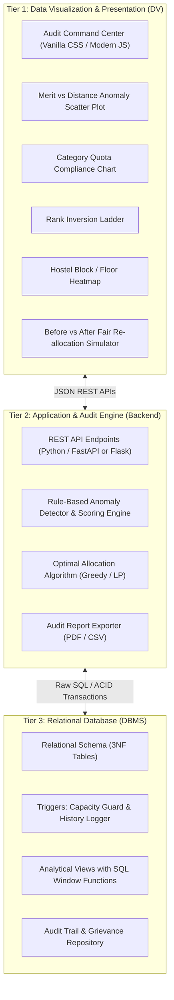
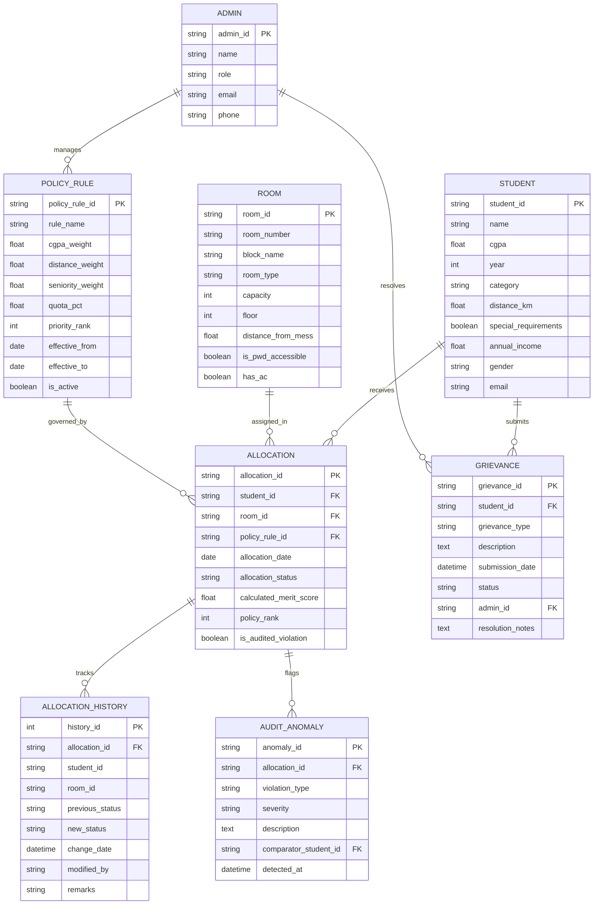
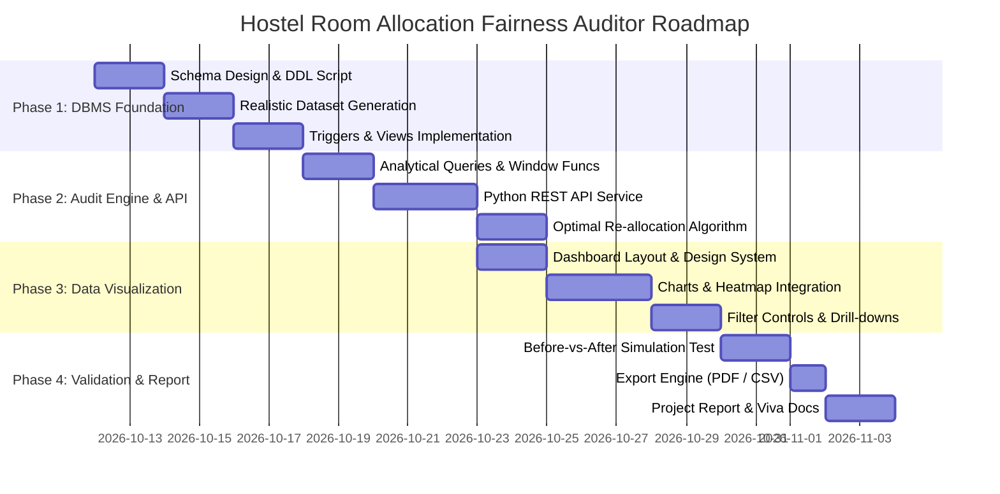

# Implementation Plan: Hostel Room Allocation Fairness Auditor
**Course:** Mini Project for Database Management Systems (DBMS) & Data Visualization (DV)  
**Team Members:**
1. Zaid Attar (612415015)
2. Arpit Tiwari (612415012)
3. Trushant Chilvery (612415040)
4. Aryan Bhure (612415030)

---

## 1. Executive Summary & Project Purpose

Hostel room allocation in academic institutions frequently suffers from opaque decision-making, arbitrary overrides, and inconsistent application of stated merit and reservation criteria. 

The **Hostel Room Allocation Fairness Auditor** is an end-to-end audit and visual analytics system designed with a dual focus:
1. **Database Management Systems (DBMS):** Enforces strict relational modeling, 3NF normalization, transactional integrity, ACID compliance, SQL triggers, and complex analytical views using SQL window functions (`RANK()`, `ROW_NUMBER()`, `PARTITION BY`).
2. **Data Visualization (DV):** Provides an interactive, insightful command-center dashboard featuring multi-dimensional anomaly scatter plots, demographic parity charts, rank inversion ladders, hostel floor heatmaps, and side-by-side "audited vs. optimal" re-allocation comparisons.

---

## 2. System Architecture

The project follows a modular, decoupled 3-tier architecture:



---

## 3. DBMS Architecture & Relational Design

### 3.1 Entity-Relationship (ER) Schema (3NF)

The schema translates and extends the official project ER diagram into normalized relational tables:



### 3.2 Key Relational Constraints & Integrity Rules
- **Domain Constraints:**
  - `STUDENT.cgpa CHECK (cgpa >= 0.00 AND cgpa <= 10.00)`
  - `STUDENT.year CHECK (year BETWEEN 1 AND 4)`
  - `ROOM.capacity CHECK (capacity > 0)`
  - `ROOM.floor CHECK (floor >= 0)`
  - `POLICY_RULE.quota_pct CHECK (quota_pct >= 0 AND quota_pct <= 100)`
  - `ALLOCATION.allocation_status CHECK (allocation_status IN ('ALLOCATED', 'WAITLISTED', 'REJECTED', 'CANCELLED'))`
- **Foreign Keys & Referential Actions:**
  - `ON DELETE CASCADE` for `ALLOCATION_HISTORY` and `AUDIT_ANOMALY` referencing `ALLOCATION`.
  - `ON DELETE RESTRICT` for `ROOM` and `STUDENT` in active `ALLOCATION` records to prevent orphaned allocations.
- **Indexes for Analytical Performance:**
  - Composite Index on `ALLOCATION(student_id, allocation_status)`
  - Index on `STUDENT(category, cgpa DESC, distance_km DESC)`
  - Index on `AUDIT_ANOMALY(violation_type, severity)`

### 3.3 Advanced DBMS Features

#### 1. SQL Triggers
- **`trg_capacity_guard` (Before Insert/Update on `ALLOCATION`):**  
  Prevents room over-allocation by verifying that current occupants of `room_id` with status `'ALLOCATED'` do not exceed `ROOM.capacity`.
- **`trg_log_allocation_history` (After Insert/Update on `ALLOCATION`):**  
  Automatically logs any allocation state change, reassignment, or manual override into `ALLOCATION_HISTORY` with timestamp and previous status.

#### 2. SQL Analytical Views (Window Functions & Aggregates)
- **`vw_student_merit_ranking`:**  
  Computes the institutional priority score and derives partitioned merit ranks:
  ```sql
  SELECT 
      s.student_id,
      s.name,
      s.category,
      s.cgpa,
      s.distance_km,
      s.year,
      (s.cgpa * 10 * 0.50 + (MIN(s.distance_km, 1000) / 1000.0) * 100 * 0.30 + (s.year * 25) * 0.20) AS computed_merit_score,
      DENSE_RANK() OVER (PARTITION BY s.category ORDER BY (s.cgpa * 10 * 0.50 + (MIN(s.distance_km, 1000) / 1000.0) * 100 * 0.30 + (s.year * 25) * 0.20) DESC) AS category_merit_rank,
      DENSE_RANK() OVER (ORDER BY (s.cgpa * 10 * 0.50 + (MIN(s.distance_km, 1000) / 1000.0) * 100 * 0.30 + (s.year * 25) * 0.20) DESC) AS overall_merit_rank
  FROM STUDENT s;
  ```
- **`vw_priority_inversions`:**  
  Identifies any pair $(A, B)$ within the same category where Student $A$ was `'ALLOCATED'` a room despite having a strictly lower merit rank than Student $B$ who was `'WAITLISTED'` or `'REJECTED'`.
- **`vw_category_quota_compliance`:**  
  Calculates category seat counts, mandated percentages vs actual allotted percentages, and deviations.
- **`vw_fairness_summary_kpi`:**  
  Rolls up system-wide metrics: Total Applicants, Allotment Rate, Total Anomalies Detected, Priority Inversion Rate, and Global Fairness Index.

---

## 4. Data Visualization (DV) Architecture & Visualizations

The frontend dashboard is designed to visually communicate complex fairness and audit findings:

| Visualization Component | Chart Type | Data Dimensions | Audit Objective / Insight |
|---|---|---|---|
| **1. Merit-Distance Anomaly Matrix** | Interactive Scatter Plot with Quadrant Shading | X: Distance from Home (km)<br>Y: CGPA<br>Color: Status (Allocated / Waitlisted / Violation)<br>Size: Year of Study | Exposes biased allotments: Identifies students in the bottom-left quadrant (low CGPA, low distance) who got rooms over top-right students (high CGPA, far distance). |
| **2. Quota Parity & Disparity Chart** | Grouped & Stacked Bar Chart | X: Category (General, OBC, SC, ST, EWS, PwD)<br>Bars: Mandated Quota vs Actual Allocation % | Visualizes disparate impact and reservation compliance deviations across social categories. |
| **3. Rank Inversion Ladder** | Bump / Slope Chart | Left: Entitled Policy Rank<br>Right: Actual Allocation Status / Rank | Shows "line jumping": High-ranking lines that drop to waitlist and low-ranking lines that jump to allocation. |
| **4. Room & Floor Equity Heatmap** | 2D Grid / Heatmap Matrix | Rows: Hostel Blocks & Floors<br>Columns: Room Numbers<br>Color: Anomaly Severity / Occupancy Ratio | Highlights preferential allocation of premium amenities (ground floors, AC rooms, low-distance to mess). |
| **5. Grievance Correlation Funnel** | Sankey / Stacked Breakdown | Categories: Grievance Type &rarr; Status &rarr; Audit Flag Match | Demonstrates whether student grievances correlate with real detected system anomalies. |
| **6. Before vs After Optimal Reallocation** | Comparative Dual-Metric Radar / Gauge & Diff Table | Current Audited Allocation vs Mathematically Fair Allocation | Simulates the corrected allocation and showcases the gain in Fairness Index (e.g. 68% &rarr; 98%). |

### Interactive Features:
- **Cross-Filtering:** Filter entire dashboard dynamically by Academic Year, Category, Gender, and Anomaly Severity.
- **Direct Drill-Down Modal:** Clicking any outlier dot on the scatter plot opens a student modal with their complete profile, comparator students, and rule violations.
- **One-Click Audit Report Export:** Export printable, formatted PDF and CSV audit certificates for institutional authorities.

---

## 5. Audit Logic & Mathematical Formulation

### 5.1 Composite Merit Formula
$$\text{Score}_i = w_{\text{cgpa}} \cdot \left(\frac{\text{CGPA}_i}{10} \times 100\right) + w_{\text{dist}} \cdot \min\left(\frac{\text{Dist}_i}{\text{MaxDist}} \times 100, 100\right) + w_{\text{sen}} \cdot (\text{Year}_i \times 25) + \text{Bonus}_{\text{special}}$$
*Default institutional weights:* $w_{\text{cgpa}} = 0.50$, $w_{\text{dist}} = 0.30$, $w_{\text{sen}} = 0.20$.

### 5.2 Priority Inversion Anomaly Rule
For any students $i$ and $j$ in Category $C$:
$$\text{Violation}_{\text{inversion}} = \left( \text{Status}_i = \text{'ALLOCATED'} \land \text{Status}_j \in \{\text{'WAITLISTED'}, \text{'REJECTED'}\} \land \text{Score}_i < \text{Score}_j \right)$$

### 5.3 Institutional Fairness Index (IFI)
$$\text{IFI} = 100 - \left( 40 \times \frac{N_{\text{inversions}}}{N_{\text{total\_allocated}}} + 30 \times \text{Disparity}_{\text{quota}} + 30 \times \text{Breach}_{\text{special\_needs}} \right)$$
*Score ranges from 0% (Severely Biased) to 100% (Strictly Fair).*

---

## 6. Implementation Phases & Roadmap



### Milestone Details

#### Milestone 1: Relational Database Setup & Seed Data
- Create `database/schema.sql` with all 8 entities, foreign keys, and check constraints.
- Create `database/triggers.sql` for capacity checks and audit logs.
- Create `database/views.sql` with window functions for ranking and inversion detection.
- Create `database/seed_data.sql` with ~100 realistic student records, 40 rooms across 2 hostel blocks, active policies, sample grievances, and pre-programmed anomalies (subtle priority inversions and quota discrepancies) for auditing demonstrations.

#### Milestone 2: Backend API & Auditing Service
- Setup lightweight Python backend (`app.py`) with zero external DB dependencies using SQLite/PostgreSQL compatibility.
- Expose REST API endpoints:
  - `GET /api/kpi-summary`: High-level fairness metrics.
  - `GET /api/anomalies`: List of flagged priority inversions and quota breaches.
  - `GET /api/scatter-data`: Data points for CGPA vs Distance with audit classifications.
  - `GET /api/quota-compliance`: Mandated vs allocated proportions.
  - `GET /api/floor-heatmap`: Block/floor room occupancy and accessibility status.
  - `POST /api/simulate-optimal`: Generates algorithmically optimal re-allocation and calculates Delta Fairness.
  - `GET /api/grievances`: Grievance logs with status and anomaly cross-reference.

#### Milestone 3: Data Visualization Frontend Dashboard
- Build responsive UI with dark/light theme, modern typography, and glassmorphic cards.
- Implement Chart.js / Plotly interactive charts:
  - Quadrant Scatter Matrix with tooltips and zoom.
  - Quota Compliance Grouped Bar Chart.
  - Interactive Hostel Floor Heatmap.
  - Rank Inversion Bump Chart.
  - Before vs After Optimal Reallocation Comparator.
- Implement live filter toolbar (Academic Year, Category, Room Type, Severity).

#### Milestone 4: Verification, Audit Export & Viva Preparation
- Comprehensive test suite to verify trigger execution, view performance (`EXPLAIN QUERY PLAN`), and API responses.
- PDF / CSV report generation for audit certificates.
- Documentation for project demonstration: SQL queries booklet for external lab examiners.

---

## 7. Project File & Directory Structure

```
Hostel-Room-Allocation-Fairness-Auditor/
│
├── database/
│   ├── schema.sql                   # 3NF DDL with PK, FK, CHECK constraints
│   ├── seed_data.sql                # 100+ sample students, rooms, rules, seed allocations
│   ├── triggers.sql                 # Capacity guard & allocation history triggers
│   ├── views.sql                    # Window functions & analytical audit views
│   ├── queries.sql                  # Complex test queries for lab viva / evaluations
│   └── database.py                  # Database connection & initialization scripts
│
├── backend/
│   ├── app.py                       # REST API entry point (Flask / FastAPI)
│   ├── auditor.py                   # Audit rule engine & anomaly classifier
│   ├── optimizer.py                 # Algorithm for fair/optimal re-allocation
│   └── requirements.txt             # Minimal Python dependencies
│
├── frontend/
│   ├── index.html                   # Audit dashboard master interface
│   ├── css/
│   │   └── style.css                # Premium dashboard design system
│   └── js/
│       ├── app.js                   # API data loader & filter state manager
│       ├── charts.js                # Chart.js visualization engine (Scatter, Bar, Bump)
│       └── heatmap.js               # Hostel floor plan & room grid visualizer
│
├── docs/
│   ├── Problem_Statement.pdf        # Original project problem statement
│   ├── ER_Diagram.png               # High-res ER diagram
│   └── DBMS_DV_Viva_Guide.md        # Q&A guide for DBMS & DV viva evaluation
│
├── IMPLEMENTATION_PLAN.md           # This document
└── README.md                        # Quick start guide & execution commands
```

---

## 8. DBMS & DV Viva Evaluation Checklist

This checklist prepares the team for external academic viva and practical evaluations:

- [ ] **DBMS: 3NF Justification:** Explain functional dependencies and how each relation eliminates update, insertion, and deletion anomalies.
- [ ] **DBMS: Window Functions:** Demonstrate `DENSE_RANK() OVER (PARTITION BY category ORDER BY score DESC)` in `views.sql`.
- [ ] **DBMS: Triggers in Action:** Demonstrate an attempted insert exceeding room capacity or modifying an allocation and showing the resulting row in `ALLOCATION_HISTORY`.
- [ ] **DBMS: ACID Transactions:** Show allocation commits wrapped in transactions with rollback on failure.
- [ ] **DV: Visual Encodings:** Explain choice of visual encodings (axes, color channels, quadrant annotations) in the Anomaly Scatter Plot.
- [ ] **DV: Perception & Fairness:** Justify how the dashboard avoids misleading visual scales and clearly surfaces disparities through standardized baseline metrics.
- [ ] **DV: Interactivity:** Demonstrate cross-filtering, live tooltips, and dynamic simulation toggles.
